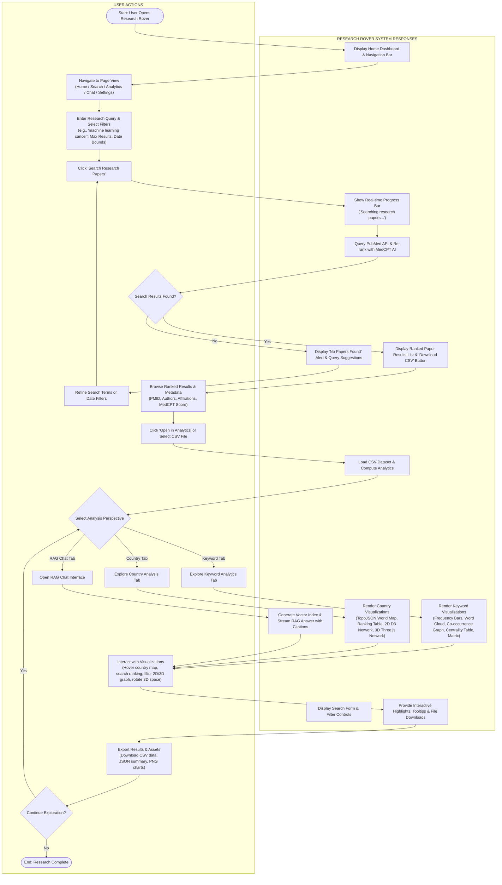
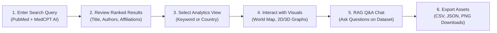

# Research Rover - User Perspective Flowchart & User Journey Document

## 1. Detailed User Journey Flowchart

---

## 2. Simplified PPT-Friendly User Flowchart

---

## 3. Explanation of User Journey Steps

1. **Start & Navigation**: The researcher accesses Research Rover and selects a workflow page from the main navigation header (Home, Search, Analytics, Chat, Settings).
2. **Formulating Search Request**: The user enters a topic query (e.g., `"machine learning cancer"`), adjusts the max result limit (e.g., 10 to 100), and optionally sets publication start/end year bounds.
3. **Executing Search & Feedback**: Clicking **Search** displays a real-time progress indicator ("Searching research papers..."). The system queries PubMed, parses affiliations/metadata, and re-ranks papers using MedCPT AI relevance scoring.
4. **Inspecting Search Results**: If papers are found, they are displayed in a clean list featuring PMID, Title, Authors, Journal, Affiliations, MeSH terms, and MedCPT relevance scores. If no results match, a clean error alert prompts the user to adjust terms.
5. **Selecting Analysis Perspective**: The user clicks **Open in Analytics** or navigates to the **Analytics Page** and picks a dataset CSV:
   - **Keyword Analytics Tab**: Displays total papers, unique keywords, frequency distribution bars, an interactive Word Cloud, a 3D-sphere co-occurrence network, NetworkX centrality scores (degree, closeness, betweenness, eigenvector, clustering), and a binary keyword presence matrix per paper.
   - **Country Analysis Tab**: Displays country publication coverage summary, unassigned paper inspection modal, an interactive TopoJSON World Map (volume shading & hover tooltips), top country publication bar chart, a complete country publication ranking table (with search), an international co-authorship partnerships table, a 2D D3 collaboration network, and a 3D Three.js force-directed space graph.
   - **Chat RAG Tab**: The user picks a dataset and types natural language questions. The system embeds the text into FAISS vector space and streams AI answers with paper citations.
6. **Interacting with Visualizations**: The user hovers over map countries, searches ranking tables, filters collaboration strength (All/Medium/Strong), rotates 3D network spaces, and zooms camera controls.
7. **Exporting Assets & Data**: The user downloads CSV files (keyword frequency, centrality scores, country ranking, co-authorships), JSON summary artifacts, or PNG chart images directly to their local computer.

---

## 4. Actual Research Rover Pages & Features Used in the Flowchart

| UI Page | Feature / View | Exact Visual Elements & Controls Implemented |
| :--- | :--- | :--- |
| **Search Page** (`/search`) | Query Input & Filters | Search bar, Max Results selector (10, 20, 50, 100), Start/End Year inputs, Raw Query mode toggle, Real-time progress panel, MedCPT AI score badges, CSV download button, "Open in Analytics" link |
| **Analytics Page** (`/analytics`) | CSV Dataset Selector | File select dropdown, Refresh button, Custom CSV file upload button, Top-N keyword limit controls (presets + custom N), Matrix preview row selector, Rebuild analysis button |
| **Analytics Page** (`/analytics`) | Keyword Analytics Tab | Summary KPI cards (Total Papers, With Keywords, Unique Keywords, Matrix Columns), Keyword Frequency progress bars, Analysis Summary metadata box, SVG Word Cloud, Co-occurrence network graph, NetworkX Centrality table, Binary Keyword Matrix |
| **Analytics Page** (`/analytics`) | Country Analysis Tab | Summary KPI cards (Total Papers, With Country Data, Without Country Data, Unique Countries, International Papers, Coverage %), Metadata Coverage split bar, Unassigned Papers inspection modal, TopoJSON World Map, Top Country Bar Chart, Complete Country Publication Ranking table (with search), International Co-Authorship Partnerships table, 2D D3 Force Network (strength filter, search, zoom/pan), 3D Three.js Force Network (rotate, zoom, particle toggle, active card overlay) |
| **Chat Page** (`/chat`) | RAG Dataset Q&A | Dataset selector, Model selector dropdown (OpenAI, DeepSeek, Groq), Vector Index generation modal (`EmbeddingProgressModal`), Streaming markdown chat responses with paper source citations |
| **Settings Page** (`/settings`) | System Configuration | API Key input fields (NCBI, OpenAI, DeepSeek, Groq), Model preference select, Dark/Light theme switcher |
