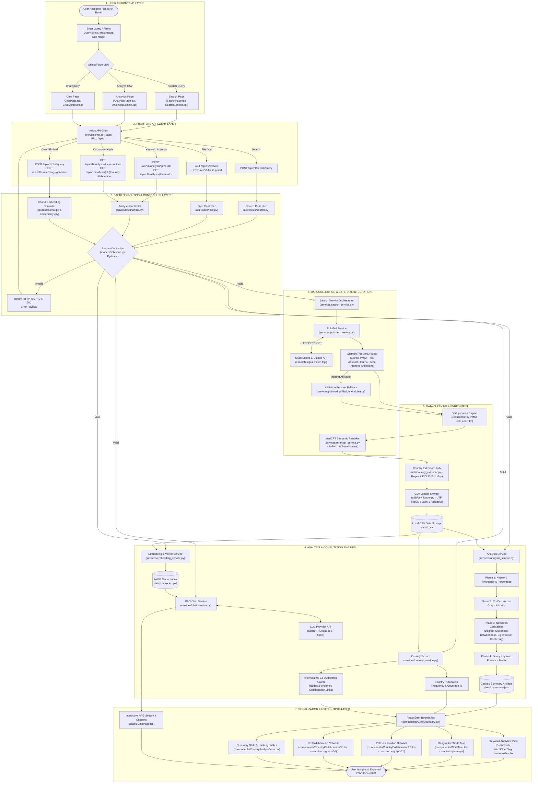
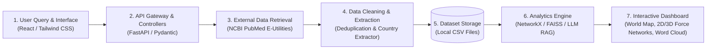

# Research Rover - System Architecture & Flowcharts Document

## 1. Detailed System Flowchart

---

## 2. Simplified PPT-Friendly Flowchart

---

## 3. Explanation of System Blocks

1. **User & Frontend Layer**: Manages user input, search query filters, page switching (`SearchPage.tsx`, `AnalyticsPage.tsx`, `ChatPage.tsx`), and UI context state (`SearchContext`, `AnalyticsContext`, `ChatContext`, `EmbeddingContext`).
2. **Frontend API Client Layer**: Axios client (`frontend/src/services/api.ts`) pointing to `/api/v1` base URL. Handles HTTP requests for search queries, file operations, keyword analytics, country analytics, embeddings, and chat completions.
3. **Backend Routing Layer**: FastAPI controllers (`api/routes/*.py`) that parse requests, validate input schemas with Pydantic (`models/schemas.py`), and return structured JSON responses or HTTP error status codes.
4. **Data Collection Layer**: Integrates with external NCBI Entrez E-Utilities (`esearch` + `efetch`), parses XML payloads, retrieves author affiliations (with fallback enrichment), and re-ranks papers semantically using MedCPT (`ncbi/MedCPT-Query-Encoder` & `ncbi/MedCPT-Article-Encoder`).
5. **Data Cleaning & Storage Layer**: Removes duplicate papers by PMID/DOI/Title, normalizes country names via regex & ISO-3166-1 mappings (`country_extractor.py`), and saves data to CSV files in `data/` via `csv_loader.py`.
6. **Analytics Engine Layer**:
   - `analysis_service.py`: Computes keyword frequencies, co-occurrence matrices, NetworkX centralities, and presence matrices.
   - `country_service.py`: Computes publication volume per country, coverage percentages, and international co-authorship collaboration graph networks.
   - `embedding_service.py` & `chat_service.py`: Builds FAISS vector store indices for RAG Q&A via LLM APIs (OpenAI, DeepSeek, Groq).
7. **Visualization & User Output Layer**: Renders interactive widgets wrapped in React Error Boundaries: TopoJSON World Map (`WorldMap.tsx`), 2D Force-Directed Network (`CountryCollaboration2D.tsx`), 3D Force-Directed Space (`CountryCollaboration3D.tsx`), Word Cloud SVG, and allows direct exports (CSV, JSON, PNG).

---

## 4. Source Code File & Module Mapping Table

| Layer / Block | Module Functionality | Actual Source Code File Paths |
| :--- | :--- | :--- |
| **Frontend UI** | Page views & state contexts | `frontend/src/pages/SearchPage.tsx` `frontend/src/pages/AnalyticsPage.tsx` `frontend/src/pages/ChatPage.tsx` `frontend/src/context/*.tsx` |
| **API Client** | Axios HTTP client & types | `frontend/src/services/api.ts` `frontend/src/types/index.ts` |
| **API Routes** | FastAPI controller endpoints | `backend/app/api/routes/search.py` `backend/app/api/routes/analysis.py` `backend/app/api/routes/chat.py` `backend/app/api/routes/embeddings.py` `backend/app/api/routes/files.py` `backend/app/models/schemas.py` |
| **Data Collection** | PubMed fetcher & MedCPT reranker | `backend/app/services/pubmed_service.py` `backend/app/services/pubmed_affiliation_enricher.py` `backend/app/services/search_service.py` `backend/app/services/reranker_service.py` |
| **Cleaning & Storage** | Normalization & CSV storage | `backend/app/utils/country_extractor.py` `backend/app/utils/csv_loader.py` `backend/data/*.csv` |
| **Analytics Engine** | Bibliometric, NetworkX & RAG | `backend/app/services/analysis_service.py` `backend/app/services/country_service.py` `backend/app/services/embedding_service.py` `backend/app/services/chat_service.py` |
| **Visualizations** | World map, 2D & 3D force networks | `frontend/src/components/CountryAnalysisView.tsx` `frontend/src/components/WorldMap.tsx` `frontend/src/components/CountryCollaboration2D.tsx` `frontend/src/components/CountryCollaboration3D.tsx` `frontend/src/components/ErrorBoundary.tsx` |

---

## 5. Architectural Clarifications

1. **Database**: The system uses file-system CSV storage (`data/*.csv`) and FAISS vector indices (`.index`, `.pkl`), not a SQL database like PostgreSQL or MongoDB.
2. **Citation Networks**: Paper records store numeric citation counts or reference strings from PubMed metadata, but explicit paper-to-paper citation graph network analysis is not implemented (co-authorship and keyword co-occurrence graphs are implemented).
