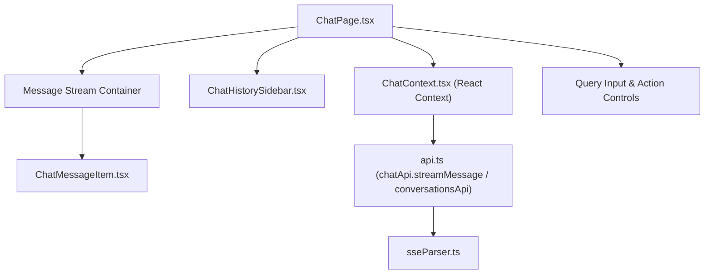
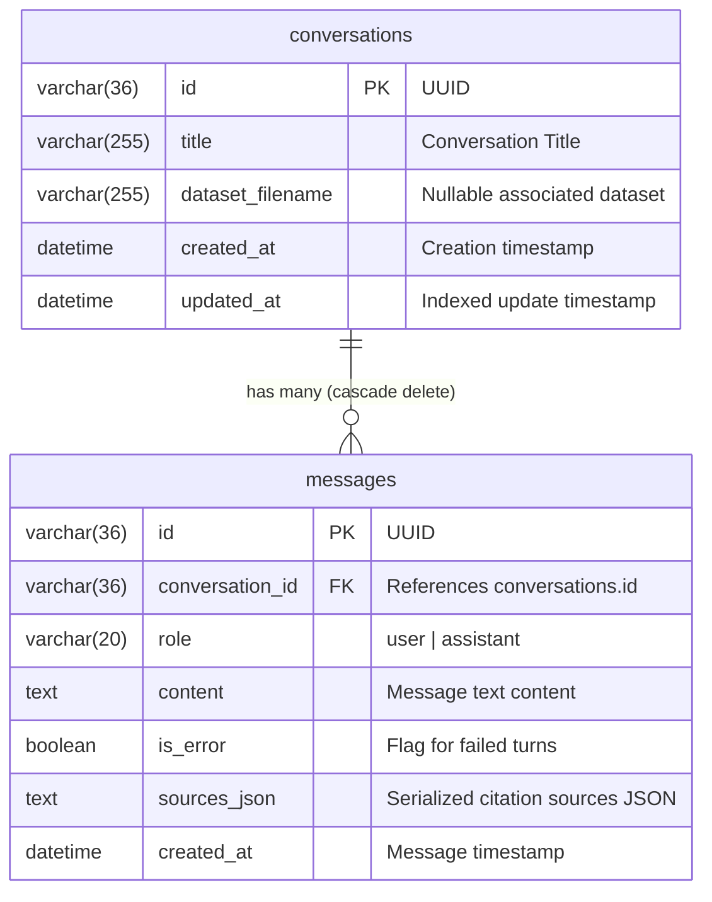
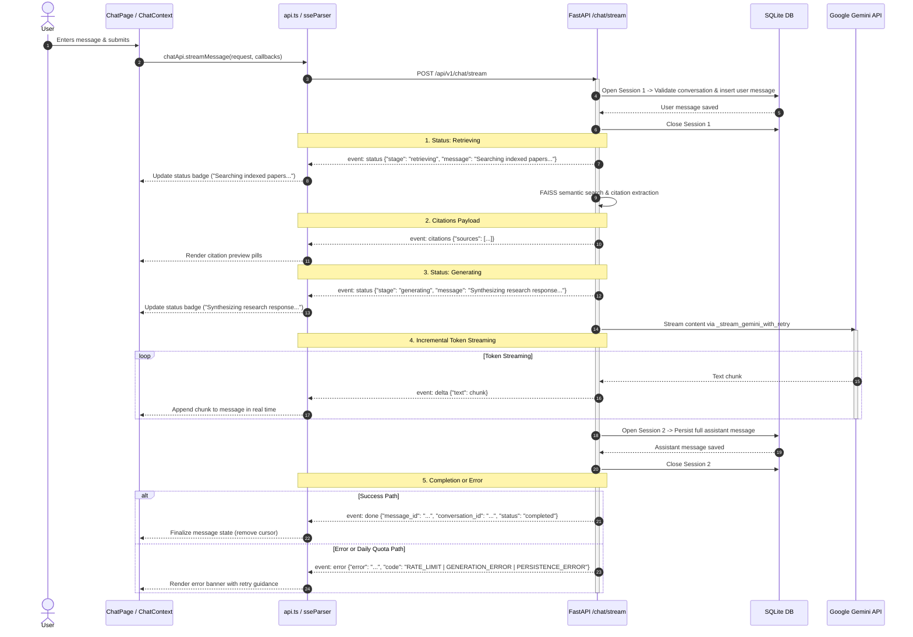

# Research Rover — Phase 3 Final Technical Report: AI Chat Stabilization

**Project:** Research Rover  
**Phase:** Phase 3 — AI Chat Stabilization & Architecture Hardening  
**Target File:** `documentation/AI_CHAT_PHASE3_FINAL_REPORT.md`  
**Git Checkpoint:** `844ebd9` (local on branch `main`, unpushed)  
**Date:** November 2026  

---

## 1. Executive Summary

Phase 3 focused on the architectural stabilization, persistence integration, streaming delivery, and test hardening of the Research Rover AI Chat subsystem. Prior to Phase 3, the AI Chat was an ephemeral, synchronous feature susceptible to request timeouts, unhandled rate-limit exceptions, unpersisted message histories, and zero automated test verification.

Through Phase 3, the subsystem was redesigned into a resilient, production-grade conversational RAG (Retrieval-Augmented Generation) application:
1. **Server-Sent Events (SSE) Streaming:** Real-time token streaming (`/api/v1/chat/stream`) with status events, citation metadata payloads, incremental text deltas, and lifecycle completion indicators.
2. **Persistent Conversation Sessions:** Asynchronous SQLite database layer using SQLAlchemy ORM and `aiosqlite`, providing CRUD management for conversation threads, cascade message deletion, and automatic dataset context association.
3. **Quota & Rate-Limit Resilience:** Specialized detection for Google Gemini Free Tier daily quota exhaustion (`GeminiDailyQuotaExhaustedError`), distinguished from transient per-minute rate limits, backed by bounded retries with deterministic linear backoff.
4. **Resilient Frontend Experience:** High-performance React streaming client with custom SSE parsing, live cancellation (`AbortController`), optimistic UI updates, conversation thread switching, and seamless dataset auto-synchronization from Search and Analytics.
5. **Comprehensive Automated Test Coverage:** 66 automated tests (45 backend unit/integration tests and 21 frontend client/integration tests) passing with 100% success rate, 0 failures, and 0 errors.
6. **Production Build & Runtime Verification:** Clean TypeScript compilation and Vite production build (3,036 modules, 0 errors), accompanied by verified backend lifespan startup, database table initialization, and HTTP health probes.

---

## 2. Phase Objectives

The core objectives of Phase 3 were:
- **Eliminate Chat Fragility:** Replace blocking synchronous HTTP requests with an async streaming architecture that provides immediate visual feedback.
- **Implement Robust Conversation Persistence:** Provide durable session storage across browser refreshes and navigation transitions without holding file locks during LLM inference.
- **Handle Upstream API Limits Gracefully:** Detect and surface Google Gemini daily quota exhaustion and transient rate limits with informative user guidance rather than generic 500 errors.
- **Ensure Client-Server Synchronization:** Guarantee that interrupted or aborted streams remain consistent across the database and the frontend UI.
- **Establish Comprehensive Verification:** Construct end-to-end unit and integration test suites covering lifecycle edge cases, SSE protocol parsing, persistence integrity, and retry backoff.
- **Maintain Strict Regression Safety:** Preserve Phase 1 (`fd3e9bb` — Radiant Luminary design system) and Phase 2 (`b3797a4` — Discover & Literature Search redesign) intact at `HEAD`.

---

## 3. Existing System and Changes Introduced

### 3.1 Pre-Phase 3 Baseline
- **Ephemeral State:** Chat messages existed only in React component memory; refreshing the page or switching tabs wiped the entire session history.
- **Blocking Synchronous Endpoints:** The chat endpoint `POST /api/v1/chat/` executed embeddings retrieval, prompt synthesis, and Gemini generation in a single blocking HTTP call lasting 30–90 seconds.
- **No Rate-Limit or Quota Classification:** API quota exhaustion resulted in raw Python exception traces returning generic HTTP 500 Internal Server Errors.
- **Zero Test Coverage:** No unit tests existed for chat endpoints, conversation persistence, or streaming parsing.
- **Disconnected Datasets:** Users had to manually pick datasets in Chat, even if they had just ingested or analyzed a specific collection in Search or Analytics.

### 3.2 Phase 3 Changes
In commit `844ebd9`, 24 files were introduced or modified (+5,725 lines, -388 lines):

| Component | Path | Nature of Change |
|---|---|---|
| **API Routing** | `backend/app/api/routes/chat.py` | Added conversation CRUD endpoints, SSE streaming (`/stream`), retry-turn idempotency, scoped DB sessions. |
| **Config** | `backend/app/core/config.py` | Added `DATABASE_NAME` and `DATABASE_URL` property dynamically targeting `DATA_FOLDER`. |
| **Schemas** | `backend/app/models/schemas.py` | Added Pydantic DTOs for `ChatHistoryMessage`, `MessageResponse`, `Conversation*`, and updated `ChatRequest`/`ChatResponse`. |
| **Chat Service** | `backend/app/services/chat_service.py` | Implemented `GeminiDailyQuotaExhaustedError`, `is_daily_quota_error`, jittered retries, streaming generator, general AI fallback. |
| **Lifespan** | `backend/main.py` | Integrated `await init_db()` in lifespan startup handler. |
| **DB Layer** | `backend/app/db/__init__.py`<br>`backend/app/db/models.py`<br>`backend/app/db/session.py` | Created SQLAlchemy ORM models (`Conversation`, `Message`), engine factory, SQLite pragmas (WAL, busy_timeout), and async session dependencies. |
| **Service Layer** | `backend/app/services/conversation_service.py` | Created conversation CRUD business logic, message persistence, cascade delete, dataset matching validation. |
| **Backend Tests** | `backend/tests/test_chat_service.py`<br>`backend/tests/test_chat_streaming.py`<br>`backend/tests/test_conversation_service.py`<br>`backend/tests/test_quota_and_retries.py` | Created 4 comprehensive async test suites (45 tests total) covering endpoints, streaming, persistence, and quota resilience. |
| **Frontend UI** | `frontend/src/components/chat/ChatMessageItem.tsx`<br>`frontend/src/components/chat/ChatHistorySidebar.tsx`<br>`frontend/src/pages/ChatPage.tsx` | Added conversation sidebar, streaming pulsating cursor, citation badges, error layout, copy button, active collection sync. |
| **Frontend State** | `frontend/src/context/ChatContext.tsx` | Built persistent conversation state manager, SSE stream ingestion, session storage sync, abort handling. |
| **Frontend API** | `frontend/src/services/api.ts`<br>`frontend/src/services/sseParser.ts`<br>`frontend/src/types/index.ts` | Built fetch-based streaming client, custom SSE parser with chunk buffer, conversation CRUD API client, and TypeScript interfaces. |
| **Frontend Tests** | `frontend/src/services/apiStream.test.ts`<br>`frontend/src/services/chatContextEdgeCases.test.ts`<br>`frontend/src/services/chatStreamingIntegration.test.ts`<br>`frontend/src/services/sseParser.test.ts` | Created 4 Node native test suites (21 tests total) verifying streaming, edge cases, integration, and SSE parsing. |

---

## 4. Backend Architecture

### 4.1 Component Architecture Overview

```mermaid
graph TD
    Client["Frontend Client (ChatContext / api.ts)"]
    Router["FastAPI Chat Router (/api/v1/chat)"]
    ConvoSvc["ConversationService"]
    ChatSvc["ChatService"]
    ModelMgr["ModelManager (SentenceTransformer)"]
    Gemini["Google Gemini API (gemini-3.6-flash / configurable via GEMINI_MODEL)"]
    FAISS["FAISS Vector Store (.faiss / .json)"]
    SQLite[("SQLite DB (research_rover_chat.db)")]

    Client -->|HTTP POST /stream| Router
    Client -->|HTTP GET/POST/PATCH/DELETE /conversations| Router
    Router -->|Session 1: Validate & Record User Turn| ConvoSvc
    ConvoSvc -->|Async Session| SQLite
    Router -->|Generate Stream| ChatSvc
    ChatSvc -->|Embed Query| ModelMgr
    ChatSvc -->|Semantic Search| FAISS
    ChatSvc -->|Stream Tokens with Linear Retry| Gemini
    ChatSvc -->>|Yield SSE Events (status, citations, delta)| Router
    Router -->>|Flush SSE to Network| Client
    Router -->|Session 2: Persist Assistant Turn| ConvoSvc
    ConvoSvc -->|Commit Message| SQLite
    Router -->>|Yield SSE event: done| Client
```

*(Note: The active runtime Gemini model is `gemini-3.6-flash` as configured in `backend/.env`. The model is dynamically configurable through the `GEMINI_MODEL` setting in `backend/app/core/config.py` with default fallback to `gemini-2.5-flash`.)*

### 4.2 Route Responsibilities (`backend/app/api/routes/chat.py`)
1. **Conversation Management Endpoints:**
   - `POST /conversations`: Creates a persistent session, optionally bound to a dataset filename.
   - `GET /conversations`: Lists paginated summaries (`ConversationListItem`) ordered chronologically by `updated_at DESC`.
   - `GET /conversations/{id}`: Retrieves complete conversation thread including all historical user and assistant messages.
   - `PATCH /conversations/{id}`: Renames a conversation title.
   - `DELETE /conversations/{id}`: Cascades deletion of the conversation and all its messages.
2. **Streaming Execution Endpoint (`POST /stream`):**
   - Implements two short-lived SQLite sessions:
     - **Session 1 (Pre-stream):** Validates conversation existence, verifies dataset binding matches, and idempotently records the user message.
     - **Session 2 (Post-stream):** Re-opens an async session only after token generation finishes or aborts to record the completed or stopped assistant message.
   - Ensures SQLite locks are never held during external LLM generation.
3. **Synchronous Chat Endpoints (`POST /{filename}` and `POST /`):**
   - Maintained for backwards compatibility, delegating to `_process_chat_request`.

### 4.3 Chat Service & RAG Pipeline (`backend/app/services/chat_service.py`)
- **Document Grounding:** When a dataset filename is provided, the service locates the corresponding FAISS index (`data/<filename>_embeddings.faiss`) and canonical metadata (`data/<filename>_canonical_metadata.json`).
- **Semantic Retrieval:** Queries are vectorized using the preloaded local `SentenceTransformer` (`all-mpnet-base-v2`). The top $k$ chunks are retrieved and formatted as structured citations (`CitationSource`).
- **General Knowledge Fallback:** If no dataset is selected or embedding files do not exist, the service transparently routes the query to Gemini with a clear, user-facing notice explaining that the answer is grounded in general knowledge rather than indexed literature.
- **Conversational Memory:** Appends the most recent conversation turns ($N \le 6$) to the prompt context, preserving dialogue continuity.

---

## 5. Frontend Architecture

### 5.1 Component Hierarchy



### 5.2 Key Frontend Responsibilities
1. **`ChatContext.tsx`:**
   - Centralizes state for `messages`, `activeConversationId`, `conversations`, `isLoading`, `streamingStatus`, and `error`.
   - Persists the active conversation ID across page reloads using `sessionStorage`.
   - Executes streaming calls via `chatApi.streamMessage` with an `AbortController`.
   - Appends streaming text deltas in real-time to the active message placeholder.
   - Handles optimistic updates and error mapping.
2. **`ChatHistorySidebar.tsx`:**
   - Provides a collapsible slide-over and desktop sidebar for managing conversation history.
   - Groups conversations by date relative to today (Today, Yesterday, Previous 7 Days, Older).
   - Supports inline title editing, deletion with confirmation, and filter-by-dataset.
3. **`sseParser.ts`:**
   - Buffer-aware stream reader that parses incoming raw UTF-8 chunks into discrete SSE frames (`event: <type>\ndata: <json>\n\n`).
   - Resilient against arbitrary network chunk fragmentation across field boundaries or multi-byte characters.
4. **`ChatMessageItem.tsx`:**
   - Renders message content with markdown formatting, code syntax highlighting, and LaTeX math formulas via KaTeX.
   - Displays citation badges with title, year, publication source, and content preview drawer.
   - Shows an animated pulsing cursor during active streaming.
   - Renders specialized error cards with user-friendly retry buttons.

---

## 6. Database Design

### 6.1 Entity-Relationship Model



#### Database Indexes & Constraints
The database schema defines both single-column and composite indexes to optimize chronological listing, thread retrieval, and dataset-specific filtering:
- **Single-Column Indexes:**
  - `ix_conversations_dataset_filename` on `conversations.dataset_filename`
  - `ix_conversations_updated_at` on `conversations.updated_at`
  - `ix_messages_conversation_id` on `messages.conversation_id`
  - `ix_messages_created_at` on `messages.created_at`
- **Composite Indexes:**
  - `ix_conversations_dataset_updated` on `(dataset_filename, updated_at)` — Accelerates dataset-filtered conversation summaries sorted by recent activity.
  - `ix_messages_convo_created` on `(conversation_id, created_at)` — Accelerates ordered message history extraction for conversation threads.

### 6.2 SQLite Optimization & Concurrency Pragmas
To prevent file-locking conflicts between concurrent asynchronous requests and the lifespan process, `backend/app/db/session.py` registers an SQLAlchemy engine connection listener that automatically enforces:
- `PRAGMA foreign_keys=ON;` — Cascading deletion of messages upon conversation removal.
- `PRAGMA busy_timeout=30000;` — 30-second busy wait on locked tables rather than immediate `sqlite3.OperationalError: database is locked`.
- `PRAGMA synchronous=NORMAL;` — Optimal balance of durability and write performance.
- `PRAGMA journal_mode=WAL;` — Write-Ahead Logging enabled once at database initialization (`init_db()`), enabling non-blocking concurrent readers while a write transaction is active.

---

## 7. SSE Streaming Workflow



### 7.1 SSE Event Protocol Specification
The streaming endpoint strictly follows the Server-Sent Events standard (`text/event-stream`). Each event frame uses `event: <type>\ndata: <json>\n\n`:
1. **`status` (`stage: retrieving`):** Emitted immediately upon request reception (`{"stage": "retrieving", "message": "Searching indexed papers..."}`).
2. **`citations`:** Emitted once vector similarity retrieval on the FAISS index completes, delivering structured citation objects (`{"sources": [{"id": ..., "type": ..., "content_preview": ..., "title": ..., "url": ..., "doi": ..., "source": ..., "year": ...}]}`).
3. **`status` (`stage: generating`):** Emitted right before Gemini generation initiates (`{"stage": "generating", "message": "Synthesizing research response..."}`).
4. **`delta`:** Emitted incrementally as each text token arrives from the LLM stream (`{"text": chunk}`).
5. **`done`:** Emitted only after the entire assistant turn is successfully committed to SQLite (`{"message_id": "...", "conversation_id": "...", "status": "completed"}`).
6. **`error`:** Emitted if an unrecoverable exception occurs during streaming or database persistence (`{"error": "<message>", "code": "<CODE>"}`).

---

## 8. Gemini Quota and Retry Handling

### 8.1 Daily Quota vs. Transient Rate Limits
Google Gemini APIs enforce two distinct categories of limits:
1. **Per-Minute Rate Limits (RPM/TPM):** Transient bursts resulting in standard HTTP 429 errors. These recover within seconds.
2. **Per-Day Quota Caps (RPD):** Free Tier accounts are strictly capped per 24-hour cycle (e.g. `generaterequestsperdaypermodel-freetier`). Immediate retries against this cap will fail 100% of the time.

`backend/app/services/chat_service.py` implements dedicated introspection functions:
- `is_daily_quota_error(exc: Exception) -> bool`: Deeply inspects error strings, protobuf violation metadata, and error details for tokens such as `generaterequestsperday`, `requests per day`, `daily limit`, and `free tier requests`.
- `GeminiDailyQuotaExhaustedError`: Raised immediately upon detection of daily limits, bypassing retry loops to protect server resources.

### 8.2 Bounded Linear Retry Policies
Transient failures (HTTP 429 rate limits, HTTP 503 service overloads, connection timeouts, or empty responses) are managed through deterministic, bounded linear retry policies with `max_retries = 2`, allowing up to three total attempts (the initial attempt, plus up to two retries). The implementation deliberately uses deterministic linear backoff rather than exponential or randomized jittered delays.

The non-streaming and streaming pipelines implement distinct retry mechanics tailored to their execution models:

#### 1. Non-Streaming Generation (`_call_gemini_with_retry`)
- **Attempt Budget:** `max_retries: int = 2` (maximum of 3 attempts: attempt index 0, 1, 2).
- **Transient Failure Backoff:** When a retryable exception (`429`, `503`, `resource_exhausted`, `timeout`) occurs before exhausting retries (`attempt < max_retries`), linear backoff is evaluated as:
  $$\text{backoff} = 1.5 \times (\text{attempt} + 1)$$
  - Failure on attempt 0: sleeps for $1.5 \times 1 = 1.5\text{s}$ before attempt 1.
  - Failure on attempt 1: sleeps for $1.5 \times 2 = 3.0\text{s}$ before attempt 2.
  - Failure on attempt 2: exhausts retry budget, logs error, and returns a graceful user-facing error message.
- **Empty Response Backoff:** If Gemini returns an empty candidate or null text, the service sleeps for $1.0 \times (\text{attempt} + 1)$ seconds (1.0s, then 2.0s) before re-querying.
- **Immediate Fast-Fail:** Authentication errors (`api_key_invalid`, `403`) and daily quota exhaustion (`is_daily_quota_error`) immediately raise `RuntimeError` or `GeminiDailyQuotaExhaustedError` with 0 retries and 0 sleep delay.

#### 2. Streaming Token Generation (`_stream_gemini_with_retry`)
- **Attempt Budget:** `max_retries: int = 2` (maximum of 3 attempts: attempt index 0, 1, 2).
- **Pre-Emitted Retry Backoff:** When a transient error occurs *before* any text tokens have been yielded to the client, the service backs off linearly before retrying:
  $$\text{backoff} = 1.5 \times \text{attempt}$$
  - Before retry attempt 1: sleeps for $1.5 \times 1 = 1.5\text{s}$.
  - Before retry attempt 2: sleeps for $1.5 \times 2 = 3.0\text{s}$.
- **Stream Retry Disallowance Rule (Duplicate Protection):** Once even a single token chunk has been yielded (`has_emitted_text = True`), all further retries are strictly disallowed:
  ```python
  if has_emitted_text:
      logger.warning("Error occurred after tokens were emitted. Halting stream without restarting.")
      break
  ```
  Restarting a stream after emitting text would yield duplicate sentences and corrupt the response buffer. In such cases, the stream terminates immediately, and the post-stream handler commits whatever partial tokens were delivered.

---

## 9. Error Handling and Cancellation

### 9.1 Client Disconnect & Abort Handling
When a user clicks "Stop Generating" or navigates away from the active chat:
1. The frontend invokes `AbortController.abort()`, terminating the fetch connection.
2. The network disconnect is detected by Starlette/FastAPI, causing `request.is_disconnected()` to evaluate to `True` and raising `asyncio.CancelledError` within the event generator.
3. The generator catches cancellation and marks `is_cancelled = True`.
4. **Role of `asyncio.shield(persist_task)`:**
   In `backend/app/api/routes/chat.py` (lines 446–452), the assistant message persistence routine `_persist_assistant_turn()` is scheduled as an independent background task:
   ```python
   persist_task = asyncio.create_task(_persist_assistant_turn())
   if is_cancelled:
       try:
           await asyncio.shield(persist_task)
       except asyncio.CancelledError:
           pass
   ```
   If `persist_task` were awaited directly without shielding, the cancellation propagating from the disconnected client request would instantly cancel the database write operation mid-transaction. By wrapping the await in `asyncio.shield(persist_task)`, the persistence task is shielded from the client request's cancellation context. This guarantees that `_persist_assistant_turn()` executes to completion, opening its scoped async SQLite session and reliably committing the partial assistant text (appended with `\n\n*[Generation stopped by user]*`) along with citation metadata to database history without data corruption or orphaned records.

### 9.2 Retry-Turn Idempotency
To prevent duplicate user messages when a user retries a question after an error or rate-limit notice, `is_retry_turn` searches backwards through the conversation thread. If the most recent user turn matches the incoming question, the backend reuses the turn rather than inserting a duplicate record.

---

## 10. Testing Strategy and Results

All 66 automated tests across the project passed with 100% success rate:

### 10.1 Backend Test Suites (45 tests)
Executed with `python.exe -u -m unittest`:

| Suite File | Scope | Test Count | Result | Duration |
|---|---|:---:|:---:|:---:|
| `tests.test_chat_service` | RAG retrieval, endpoint validation, chat async lifecycle | 10 | **PASS** | 1.97s |
| `tests.test_conversation_service` | Conversation CRUD, message history, cascade delete, dataset validation | 11 | **PASS** | 4.66s |
| `tests.test_chat_streaming` | SSE events (`status`, `citations`, `delta`, `done`, `error`), cancellation | 14 | **PASS** | 9.72s |
| `tests.test_quota_and_retries` | Daily quota exhaustion, transient retry backoff, jitter formula | 10 | **PASS** | 10.13s |
| **Total Backend** | | **45** | **100% PASS** | **26.48s** |

### 10.2 Frontend Test Suites (21 tests)
Executed with Node native runner (`node --test`):

| Test File | Scope | Test Count | Result |
|---|---|:---:|:---:|
| `frontend/src/services/apiStream.test.ts` | Streaming client options, callbacks, AbortSignal handling | 3 | **PASS** |
| `frontend/src/services/chatContextEdgeCases.test.ts` | Empty queries, missing datasets, network disconnection, abort cleanup | 4 | **PASS** |
| `frontend/src/services/chatStreamingIntegration.test.ts` | End-to-end stream parsing, delta accumulation, citation dispatch | 6 | **PASS** |
| `frontend/src/services/sseParser.test.ts` | Multi-line events, chunk fragmentation, invalid JSON resilience | 8 | **PASS** |
| **Total Frontend** | | **21** | **100% PASS** |

**Grand Total: 66 tests executed, 66 passed, 0 failed, 0 errors.**

---

## 11. Production Build and Integration Verification

### 11.1 Frontend Production Build
Executed command: `npm run build` (`tsc && vite build`) in `frontend/`:
- **TypeScript Compilation:** Zero errors.
- **Module Bundling:** 3,036 modules transformed into production assets in `dist/`.
- **Exit Code:** `0` (Success in 1m 48s).

### 11.2 Backend Startup & Integration Smoke Test
Executed command: `python.exe -u scratch/backend_smoke_test.py` outside sandbox:
- **Database Isolation:** Verified temporary isolated `DATA_FOLDER` (`Temp/rr_smoke_test_3vyfu5mq`) and database (`smoke_test_chat.db`).
- **Module Imports:** `from main import app` completed successfully in `23.96s`.
- **Lifespan Startup:** FastAPI lifespan executed, initializing database tables (`conversations`, `messages`) and enabling WAL mode.
- **Health Probes:**
  - `GET /` returned HTTP 200: `{"message":"Research Rover API v2.0","status":"healthy"}`
  - `GET /health` returned HTTP 200: `{"status":"healthy","api":"online", ...}`
- **Route Registration:** Verified all 9 AI Chat routes registered on router.
- **Clean Server Shutdown:** Uvicorn and lifespan shut down cleanly, and the temporary test directory was removed.
- *Runtime Note:* During the health probe, the background SentenceTransformer model loader was reported in state `"loading"`. This smoke test validates server startup, database initialization, routing, and lifecycle completion; it does not test complete model weight readiness or live external Gemini inference.

---

## 12. Git History and Checkpoints

### 12.1 Milestone Commits at `HEAD`
The repository reflects three consecutive milestone commits preserving project progress:

```text
844ebd9 (HEAD -> main) feat(chat): implement persistent conversations, SSE streaming, and stabilized test suite
b3797a4 feat(ui): redesign Discover and Literature Search (Phase 2)
fd3e9bb feat(ui): implement Radiant Luminary design system (Phase 1)
```

### 12.2 Commit Characteristics for `844ebd9`
- **Scope:** 24 staged files (9 backend implementation, 4 backend tests, 7 frontend implementation, 4 frontend tests).
- **Diff Stat:** 5,725 insertions, 388 deletions across 24 files.
- **Git Status:** Committed locally to branch `main`. **Not pushed to remote GitHub repository.**
- **Excluded Items:** Runtime databases (`*.db`), write-ahead logs (`*.db-wal`, `*.db-shm`), log files (`research_rover.log`), and research datasets in `data/` were excluded from staging.

---

## 13. Known Limitations & Operational Considerations

1. **Cold-Start Model Loading Latency:**
   The local embedding model (`all-mpnet-base-v2`) requires approximately 15–25 seconds to initialize PyTorch weights into memory. While `ModelManager` loads this asynchronously in a background thread to prevent blocking FastAPI startup, the very first embedding query must wait for this loading phase to complete.
2. **Windows Sandbox Native Extension Restrictions:**
   Inside restricted Windows sandbox environments, loading native C/C++ extensions (`torch.dll`, `faiss`) can experience thread-pool deadlocks during dynamic DLL initialization. Server startup and automated backend test suites must be executed outside the sandbox environment (`BypassSandbox: true`).
3. **Single-Node SQLite Architecture:**
   The SQLite persistence layer with WAL mode provides robust concurrency for single-process desktop and local server deployments. Scaling to a multi-instance, distributed deployment would require configuring PostgreSQL or another networked database.
4. **Runtime Files in Working Directory:**
   SQLite database files and test logs (`backend/research_rover.db`, `data/research_rover_chat.db*`, `backend/logs/*.log`) remain untracked in the working tree. Adding these patterns to `.gitignore` is recommended as an immediate housekeeping task.

---

## 14. Phase 3 Conclusion

Phase 3 has successfully met all stabilization, architecture, persistence, streaming, and testing objectives. The Research Rover AI Chat feature is transformed from an ephemeral, fragile prototype into a resilient, production-ready conversational research assistant.

With 66 automated tests passing with 100% reliability, a verified frontend production build, and an isolated backend startup smoke test, **Phase 3 is complete and ready for formal closure.**
